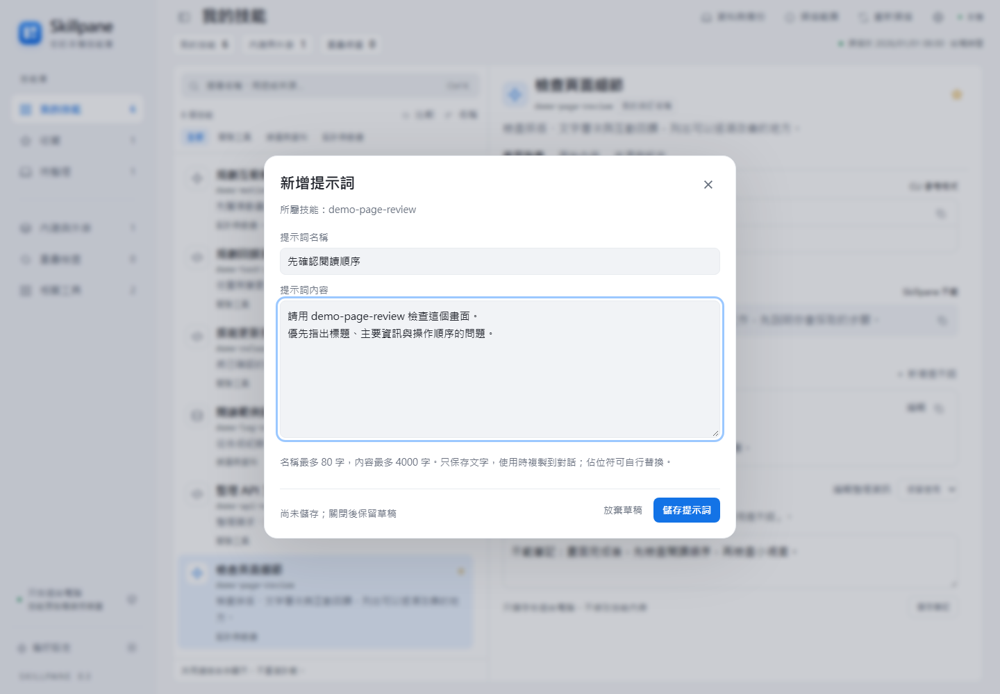
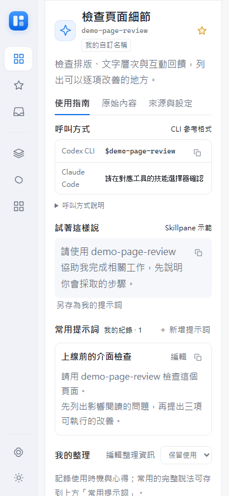

# 三分鐘操作導覽

從「找得到」開始，再保存自己的用法。以下為 0.3.2 介面截圖，全部使用 `demo-` 開頭的虛構技能與合成筆記；技能不是安裝建議，也不代表你的實際清單。掃描時間固定為示範值。完整安裝、升級與疑難處理見 [操作手冊](USER_GUIDE.md)。

## 1. 找到要用的技能

開啟面板後，先看「我的技能」，搜尋名稱或用途；也可用分類縮小範圍。點選清單，右側會顯示用途與呼叫參考。常用項目按星號，之後從「收藏」找回。

「我的技能」與「內建與外掛」分開計算；磁碟上的項目數不等於目前對話能呼叫的數量。含 SKILL.md 的資料夾內附副本不再另外計數。遇到相近工具先比較分工，不要把「重疊候選」當成刪除建議。

## 2. 看懂原文與自己的整理

「使用指南」方便快速閱讀；「原始內容」是純文字 SKILL.md；「來源與設定」用來核對原始名稱、描述與宣告。中文名稱會標明面板補充或自訂來源。

| 區域 | 適合放什麼 | 如何使用 |
| --- | --- | --- |
| 試著這樣說 | Skillpane 提供的範例 | 可複製，或按「另存為我的提示詞」後修改 |
| 常用提示詞 | 自己反覆使用的完整說法 | 可新增多筆、編輯與一鍵複製 |
| 我的整理 | 使用時機、心得與分工筆記 | 編輯後按「儲存筆記」，不會自動變成提示詞 |

這些個人資料存於本機，不改寫技能原檔。CLI 格式僅供參考；在實際工具確認技能已載入，再貼上提示詞送出。

## 3. 保存第一筆常用提示詞

在技能的「使用指南」按「＋ 新增提示詞」，填入好辨識的名稱與完整內容，再按「儲存提示詞」。之後從該技能直接複製。每個技能最多 20 筆；名稱最多 80 字、內容最多 4,000 字。

`{{環境}}` 之類的文字需自行替換，面板不會自動代入或執行。關閉編輯器會保留本頁草稿；重新整理或關閉分頁前仍要先儲存。

## 4. 調整閱讀方式

標題左側按鈕可收合側欄，偏好設定可改主題及三種字級。桌面清單與詳情各自捲動；窄螢幕向下捲動，可在清單後閱讀技能詳情。這些偏好保存在目前瀏覽器。

上圖為 Chromium 的 390×844 視窗模擬，已向下捲至詳情；不是實體手機認證。本機服務只監聽電腦的 127.0.0.1，這張圖不表示支援手機經區網連線。

## 5. 整理後先備份

先儲存筆記與提示詞，再從右上「資料與備份」下載整理資料備份，放在專案之外妥善保管。偏好設定中的「清單匯出」用途不同，不能拿來還原筆記。

需要還原時先匯入、看預覽、核對技能對應及衝突，再套用。備份含個人文字且未加密；不要提交到 Git 或貼到 Issue。細節見 [備份與還原](USER_GUIDE.md#7-備份匯入與還原) 及 [資料隱私](PRIVACY.md)。

## 重製展示

維護者可依 [文件展示素材](TESTING.md#文件展示素材) 重製。展示服務只建立合成技能與獨立整理資料，與日常面板分開；不提供真實服務 URL 的截圖選項。畫面使用正式前端，沒有為截圖更改排版或隱藏安全提示。
